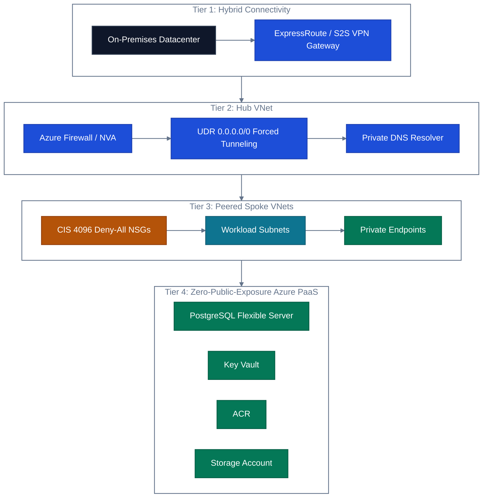

<div align="center">

# 🏗️ Azure Monolithic Landing Zone — Terraform

[](https://www.terraform.io/)
[](https://azure.microsoft.com/)
[](LICENSE)
[](https://github.com/rahulgoyaldevops/azure-caf-landing-zone-terraform/actions/workflows/terraform-ci.yml)

**Enterprise-grade Azure Landing Zone built with modular Terraform — parent/child module pattern for scalable, reusable infrastructure conforming to Microsoft Cloud Adoption Framework (CAF).**

</div>

---

## 📐 Architecture
**Architecture Decision Record**: [ADR-001: Layered State Decomposition, Hub-Spoke Networking & CIS NSGs](docs/adr/001-layered-state-and-hub-spoke.md)


```
┌─────────────────────────────────────────────────────────────────────────┐
│                          PARENT MODULE                                  │
│                                                                         │
│  ┌───────────────────────┐                                              │
│  │  CAF Management Group │                                              │
│  │  Hierarchy Module     │ (Platform, Corp, Online, Sandboxes, Decomm)  │
│  └───────────────────────┘                                              │
│                                                                         │
│  ┌──────────────┐   ┌──────────────┐   ┌──────────────┐                 │
│  │  Resource     │   │  Virtual     │   │   Subnet     │                 │
│  │  Group        │──▶│  Network     │──▶│              │                 │
│  │  Module       │   │  Module      │   │  Module      │                 │
│  └──────────────┘   └──────────────┘   └──────┬───────┘                 │
│                                                │                         │
│  ┌──────────────┐   ┌──────────────┐   ┌──────┴───────┐                 │
│  │  Route Table │   │  NSG Module  │   │  Linux VM    │                 │
│  │  (UDR 0.0.0.0│   │  (CIS 4096   │──▶│  + NIC Module│                 │
│  │   -> 10.100) │   │   Deny All)  │   │  (AZ-pinned) │                 │
│  └──────────────┘   └──────────────┘   └──────────────┘                 │
│                                                                         │
│  🔐 Secrets from Azure Key Vault (VM admin password)                    │
│  📦 Variable-driven: define infra in tfvars, not code                   │
│                                                                         │
└─────────────────────────────────────────────────────────────────────────┘
```

### 🌐 Hybrid Connectivity & Zero-Public-Exposure Private Link




## 🧩 Module Structure

```
tf-monolithic-landing-zone/
├── parentmodule/
│   ├── main.tf                    # Orchestrates all child modules
│   ├── variable.tf                # Input variables for all resources
│   ├── data.tf                    # Key Vault secret lookups
│   ├── provider.tf                # AzureRM provider config (v4.x)
│   ├── outputs.tf                 # Subnets, NSGs, Route Tables & MG IDs
│   ├── ARCHITECTURE_DEEP_DIVE.md  # Microsoft CAF Enterprise-Scale Guide
│   ├── .gitleaks.toml             # Secret scanning config
│   └── infracost.json             # Cost estimation output
│
└── child module/
    ├── management_group/           # CAF Management Groups (Platform, Corp, Online, Sandboxes)
    ├── resource_group/             # Azure Resource Group
    ├── virtual_network/            # VNet with configurable CIDR
    ├── subnet/                     # Subnet with delegation support
    ├── network_security_group/     # Granular NSG rules with default deny
    ├── route_table/                # UDR forced-tunneling (0.0.0.0/0 -> Azure Firewall)
    ├── pip/                        # Public IP allocation (Standard SKU)
    ├── network_interface/          # NIC with accelerated networking
    └── azurerm_linux_virtual_machine/ # Linux VM with Availability Zone pinning
```

## 🏛️ Microsoft Cloud Adoption Framework (CAF) Hierarchy

```
                                Tenant Root Group (/)
                                          │
                          Intermediate Root Management Group
                          (mg-enterprise / "Enterprise Root")
                                          │
    ┌───────────────────────┬─────────────┴─────────────┬────────────────────────┐
    ▼                       ▼                           ▼                        ▼
[Platform]            [Landing Zones]              [Sandboxes]            [Decommissioned]
(Management,          (Corp LZ,                    (Isolated R&D,         (Quarantine,
 Connectivity,        Online LZ)                   Zero Corp Peering)      Zero Resource Spends)
 Identity)
```

## 🚀 Key Design Decisions

| Decision | Rationale |
|:--|:--|
| **Microsoft CAF Compliance** | Management Group structure strictly separates Platform services from Corp/Online Workloads and Sandboxes |
| **Parent/Child Module Pattern** | Enforces separation of concerns — each resource type is independently versionable and testable |
| **User Defined Routing (UDR)** | Spoke subnets enforce `0.0.0.0/0` next-hop to Hub Azure Firewall (`10.100.1.4`) for zero-trust inspection |
| **Granular NSG Rules** | Subnets enforce explicit ingress allow lists and CIS-compliant priority 4096 Default Deny |
| **Availability Zone Resiliency**| VMs explicitly pinned to Availability Zones guaranteeing 99.99% infrastructure uptime SLA |
| **Variable-Driven Provisioning** | All infrastructure defined in `tfvars` — same modules deploy dev, UAT, and prod |
| **Key Vault Integration** | VM passwords fetched from Azure Key Vault at plan time — zero secrets in code or state |
| **Dependency Chaining** | Explicit `depends_on` ensures correct resource creation order |
| **Gitleaks Integration** | Pre-commit secret scanning prevents credential leaks |
| **Infracost Integration** | Cost estimation before apply — prevents cloud spend surprises |

## 💡 Usage

```bash
# Navigate to parent module
cd parentmodule

# Initialize Terraform
terraform init -backend=false

# Validate syntax & provider constraints
terraform validate

# Preview changes with cost estimation
terraform plan -var-file="environments/prod.tfvars"
```

## 🔐 Security Best Practices

- ✅ Microsoft CAF Enterprise-Scale hierarchy with policy boundaries
- ✅ Zero hardcoded secrets — Key Vault lookups via `data` blocks
- ✅ Pinned Availability Zones (`zone = "1"`)
- ✅ Network microsegmentation with subnet-level NSG bindings
- ✅ Forced tunneling egress via central Azure Firewall
- ✅ Gitleaks pre-commit scanning (`.gitleaks.toml`)
- ✅ State file excluded from git (`.gitignore`)
- ✅ Provider version pinning for reproducibility
---

<div align="center">

<sub>Designed & Implemented by <b><a href="https://github.com/rahulgoyaldevops">Rahul Goyal</a></b> — Senior DevOps & Cloud Platform Engineer (14+ Years Total IT)</sub>

<p align="center">
  <a href="https://www.linkedin.com/in/rahulgoyaldevops/" target="_blank">
    
  </a>
  &nbsp;
  <a href="https://github.com/rahulgoyaldevops?tab=repositories" target="_blank">
    
  </a>
</p>

</div>
